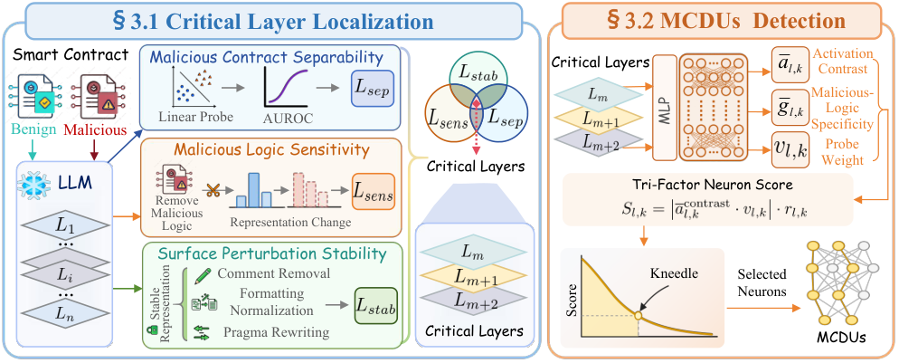

# ContractLens: Latent Security Knowledge for Malicious Smart Contract Detection

This is a Python implementation of ContractLens, a frozen-LLM probing framework for malicious smart-contract detection.



## Requirements

Experiments were conducted with:

- Python 3.12 (Ubuntu 22.04)
- PyTorch 2.5.1
- CUDA 12.4
- GPU NVIDIA V100
- Transformers 5.14.1
- scikit-learn 1.9.0

## Data

Download the SmartIntent smart-contract intent dataset from [Hugging Face](https://huggingface.co/datasets/web3se/smart-contract-intent-vul-dataset). The dataset contains verified Binance Smart Chain Solidity contracts with ten intent labels. For details, see the [SmartIntentV2 paper](https://dl.acm.org/doi/10.1145/3803846.3807464) and the authors' [GitHub project](https://github.com/web3se-lab/web3-sekit). Place the downloaded MariaDB dump (`web3_all.sql.gz`) under a local data path.

## Usage

Run commands from the repository root. Before running, set the model/data paths in the scripts that define fixed paths (`ROOT`, `SOURCE`, `UNION`, `MANIFEST`, and `MODEL`). Prepare the seed-0 group split manifest at `runs/stage4_smartintent_full_trials/manifests/trial_seed_0.json`. Model weights, manifest, and feature caches are not included.

1. Build the binary/intent datasets and sliding-window index:

```bash
python candidate_layers/build_smartintent.py --dump /path/to/web3_all.sql.gz \
  --output-dir runs/stage3_smartintent --binary-per-class 1000 --intent-per-class 500 --seed 0
python candidate_layers/build_smartintent_sliding_union.py \
  --data-dir runs/stage3_smartintent --output-dir runs/stage3_smartintent_sliding


```

2. Extract frozen, token-mean-pooled layer representations and fit layer-wise logistic probes:

```bash
python candidate_layers/extract_codegemma_token_exact_v3.py \
  --model-path /path/to/CodeGemma-7B \
  --data-path runs/stage3_smartintent_sliding/sliding_union.jsonl \
  --output-dir runs/stage8_codegemma_seed0_binary_cf_inv_v3/features_base \
  --max-length 2048 --overlap 512 --device cuda --resume
python candidate_layers/run_layerwise_probes.py \
  --features-dir runs/stage8_codegemma_seed0_binary_cf_inv_v3/features_base/features_text_mean \
  --data-path runs/stage3_smartintent_sliding/sliding_tasks/binary.jsonl \
  --output-dir runs/stage8_codegemma_seed0_binary_cf_inv_v3/results --seeds 0 \
  --split-manifest runs/stage4_smartintent_full_trials/manifests/trial_seed_0.json


```

3. Build unsafe-to-normal counterfactual pairs and semantics-preserving surface variants:

```bash
python candidate_layers/build_seed0_binary_cf_inv_v3.py
python candidate_layers/build_seed0_full_train_invariance_v3.py
python candidate_layers/select_stage8_invariance_variants.py


```

4. Extract paired and surface features, then compute the critical-layer intersection (`L_prob ∩ L_cf ∩ L_inv`):

```bash
python candidate_layers/extract_paired_full_local_features.py \
  --model-path /path/to/CodeGemma-7B \
  --data-path runs/stage8_codegemma_seed0_binary_cf_inv_v3/data_cf/paired_sources.jsonl \
  --output-dir runs/stage8_codegemma_seed0_binary_cf_inv_v3/features_cf \
  --max-length 2048 --overlap 512 --device cuda --resume
python candidate_layers/extract_codegemma_token_exact_v3.py \
  --model-path /path/to/CodeGemma-7B \
  --data-path runs/stage8_codegemma_seed0_binary_cf_inv_v3/data_inv/surface_sources_selected.jsonl \
  --output-dir runs/stage8_codegemma_seed0_binary_cf_inv_v3/features_inv \
  --max-length 2048 --overlap 512 --device cuda --resume
python candidate_layers/analyze_seed0_binary_cf_inv_v3.py \
  --stage runs/stage8_codegemma_seed0_binary_cf_inv_v3 \
  --cf-manifest runs/stage8_codegemma_seed0_binary_cf_inv_v3/data_cf/pair_manifest.jsonl \
  --cf-full runs/stage8_codegemma_seed0_binary_cf_inv_v3/features_cf/features_full_mean \
  --cf-local runs/stage8_codegemma_seed0_binary_cf_inv_v3/features_cf/features_local_mean \
  --inv-manifest runs/stage8_codegemma_seed0_binary_cf_inv_v3/data_inv/surface_manifest_selected.jsonl \
  --inv-features runs/stage8_codegemma_seed0_binary_cf_inv_v3/features_inv/features_text_mean \
  --base-features runs/stage8_codegemma_seed0_binary_cf_inv_v3/features_base/features_text_mean \
  --base-metrics runs/stage8_codegemma_seed0_binary_cf_inv_v3/results/layer_probe_metrics.csv \
  --split-manifest runs/stage4_smartintent_full_trials/manifests/trial_seed_0.json \
  --output runs/stage8_codegemma_seed0_binary_cf_inv_v3/results_strict_v5


```

5. Discover MLP neurons only in the selected critical layers. The first script scores units and applies Kneedle; the second validation-locks the score variant and evaluates unit stability:

```bash
python key_neurons/run_codegemma_dna_mlp_seed0.py \
  --model-path /path/to/CodeGemma-7B \
  --union-path runs/stage3_smartintent_sliding/sliding_union.jsonl \
  --binary-path runs/stage3_smartintent_sliding/sliding_tasks/binary.jsonl \
  --manifest-path runs/stage4_smartintent_full_trials/manifests/trial_seed_0.json \
  --output-dir runs/stage9_codegemma_seed0_dna_mlp \
  --layers <critical-layer-ids> --seed 0 --device cuda --resume
python key_neurons/stage10_stable_unit_discovery.py \
  --stage9 runs/stage9_codegemma_seed0_dna_mlp \
  --binary runs/stage3_smartintent_sliding/sliding_tasks/binary.jsonl \
  --manifest runs/stage4_smartintent_full_trials/manifests/trial_seed_0.json \
  --output runs/stage10_codegemma_seed0_stable_units \
  --layers <critical-layer-ids> --seed 0
```
Replace `<critical-layer-ids>` with the `L_critical` layer IDs in `results_strict_v5/candidate_layers_v3.json`. The backbone stays frozen: Train is used to fit probes and score units, Validation to select, and Test only for final evaluation. The scripts do not create the split manifest.


## Citation

If you find this work useful, please cite:

```bibtex
@article{miao2026contractlens,
  title={ContractLens: Latent Security Knowledge for Malicious Smart Contract Detection},
  author={Miao, Shuyi and Huang, Xinyi and Qiu, Wangjie and Shen, Fei and He, Jinchun and Zheng, Zhiming and Chua, Tat-Seng},
  journal={arXiv preprint arXiv:2610.04992},
  year={2026}
}
```
